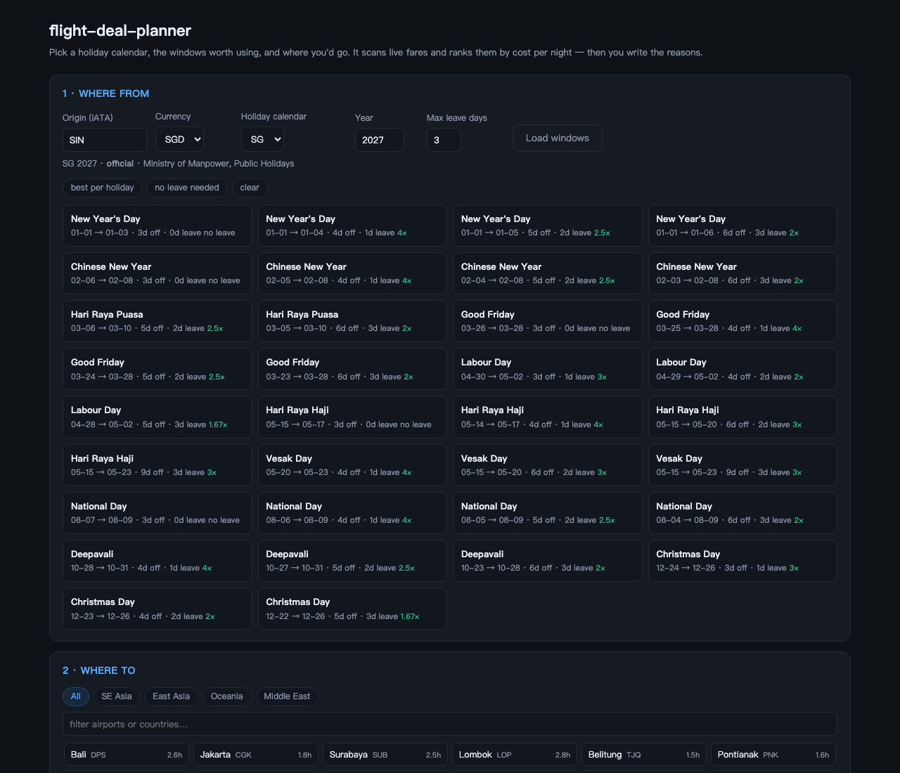

# flight-deal-planner

An [Agent Skill](https://docs.claude.com/en/docs/claude-code/skills) that plans a
year of travel around a country's public holidays: it scans **real fares**,
filters by **season** and **visa friction**, and outputs a dated plan —
*which holiday → which city → which flight → why → what to do there.*

It exists because "cheapest flight" and "trip worth taking" are different
questions. The cheapest fare in a spreadsheet is usually pointed at monsoon
season, or at a country whose visa takes three weeks.

```
holiday calendar ──► windows ──► fare scan ──► season + visa filter ──► plan
```



---

## Three ways to use it

### 1. In a browser — no CLI

```bash
python3 web/server.py          # → http://127.0.0.1:8765
```

Pick origin, holiday calendar and year, tick the windows worth using, tick the
airports you'd consider, and press **Scan**. It returns a ranked table: fare,
baggage state, fare-with-a-20kg-bag, cost per night, and how the date compares
to the other windows you scanned. Right-click an airport to mark it *visited* so
it stops being suggested.

Stdlib only — nothing to install beyond the two scraper dependencies.

### 2. As an agent skill

Drop the folder into your agent's skills directory (`~/.claude/skills/` or your
harness's equivalent) and ask it *"plan my 2027 holidays"*. It will collect the
profile in step 1 of `SKILL.md`, run the pipeline, and write the plan.

### 3. As a library / CLI

```bash
python3 scripts/holidays.py --country SG --year 2027 --max-leave 3
python3 scripts/scan.py   --spec job.json
python3 scripts/rank.py   --fares data/fares.jsonl --config config.json
python3 scripts/report.py --summary data/summary.json --out report.md
```

---

## What it actually produces

A real scan, unfiltered. Bali, April 2027, three nights, one day of leave:

```
### 2027-04-09 → 2027-04-12
Bali DPS · Scoot TR282 16:05→19:00 (2h55) · S$178 round trip ·
carry-on only, +S$38 for 20kg → S$216 · S$72/night ·
lowest of the 36 windows scanned for this route
```

And the same week in Bangkok — where the full-service fare beats the low-cost one:

```
### 2027-01-29 → 2027-02-01
Bangkok BKK · Singapore Airlines · S$276 round trip, 30kg checked included ·
S$92/night · Scoot on the same dates is S$400, so the sale flips the ranking
```

`scripts/report.py` emits the factual skeleton with a `_fill in by hand_` marker;
the *why* and the *what to do* are written by the agent from
`references/seasonality.md`. A generated example is in
[`examples/example-report.md`](examples/example-report.md).

---

## Holiday calendars

| Code | Coverage | Confidence |
|---|---|---|
| `SG` | Singapore 2026, 2027 | **official** (MOM) |
| `HK` | Hong Kong 2027 | **official** (gazetted gov.hk list) |
| `JP` | Japan, any year | rule-based — equinox days ±1 day |
| `AU` | Australia, any year | rule-based — national only, no state holidays |
| `US` | United States, any year | rule-based — federal only, with observed shifting |
| `CN` | mainland China | fixed dates only — **lunar festivals omitted** |
| `KR` | South Korea | fixed dates only — **Seollal and Chuseok omitted** |
| `MY` | Malaysia | fixed dates only — **state and Islamic holidays omitted** |

Anything not rated `official` prints a warning, because a wrong holiday date
produces a confidently wrong plan. For full coverage of any country:

```bash
python3 scripts/holidays.py --file my-holidays.csv --year 2027
# my-holidays.csv:  2027-01-01,New Year
```

---

## What it does

- **Finds the leave arbitrage.** For each holiday it computes what 1, 2 or 3
  days of annual leave actually buy, with a leave-efficiency ratio, anchored on
  that holiday — not on whichever block elsewhere in the year happens to be
  longest.
- **Scans real prices**, not estimates — Google Flights, via its server-rendered
  result page.
- **Refuses the trap.** Cheapest fares cluster in each destination's worst
  month. Season is a filter, not a tiebreak.
- **Compares fairly.** Cost per night, not absolute fare, when trip lengths
  differ. Route percentile, not "lowest ever".
- **Annotates baggage on every price**, because a carry-on fare and a
  with-a-suitcase fare often reverse the ranking.

## What it does not do

- It does not book. It produces a plan with links.
- It does not claim historical lows. The "route percentile" is cross-sectional
  across the windows it scanned, and says so.
- It does not trust one source. Shortlisted routes get a second check.

---

## Install

```bash
git clone <this repo> flight-deal-planner
cd flight-deal-planner
pip install -r scripts/requirements.txt
```

Python 3.9+.

---

## Repo layout

```
SKILL.md                       the method (what the agent executes)
web/server.py                  local web UI, stdlib only
web/index.html                 single-page front end
references/seasonality.md      month × region table + monsoon asymmetries
references/visa-and-entry.md   entry-friction framework + worked example
references/fares-and-baggage.md fare brands, baggage economics, the two asymmetries
scripts/gf.py                  Google Flights fetch + parse
scripts/holidays.py            8 holiday calendars + leave optimiser
scripts/scan.py                batch scanner (job spec driven, resumable)
scripts/rank.py                scoring and bucketing
scripts/report.py              Markdown brief skeleton
assets/                        destination catalogue, example profile/job/config
examples/                      a real generated report + UI screenshot
```

---

## How fare scanning works

`scripts/gf.py` builds Google Flights' `?tfs=` protobuf parameter (via
`fast-flights`), fetches the page, and parses the server-rendered result cards.
The plain `?q=` URL returns an empty shell, which is why this parameter matters.

Known limits, all documented in `SKILL.md` §8:

- the result list is **outbound-only** — a round-trip price shows outbound
  options paired with the cheapest acceptable return
- the list is **capped**; cells with fewer than five rows are marked unreliable
- **one-way ≠ half a round trip** on full-service carriers — a round-trip promo
  can be cheaper than a one-way
- booking horizon is ~330 days; further out returns nothing

---

## Caveats

Fares are snapshots and low-cost inventory moves within hours. Baggage fees are
estimates in the ranges given; the booking page is authoritative. Entry rules
change and `references/visa-and-entry.md` is a framework with one worked
example, not legal advice. Nothing here is a price guarantee.

## License

MIT — see `LICENSE`.
